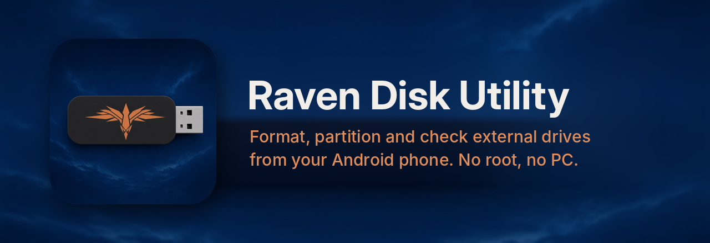

<p align="center"></p>

<p align="center">
  <a href="https://github.com/Ravenor907/Raven-Disk-Utility/releases"></a>
  <a href="https://github.com/Ravenor907/Raven-Disk-Utility/actions/workflows/android.yml"></a>
  <a href="LICENSE"></a>
</p>

# Raven Disk Utility

A disk utility for your Android phone. Plug in a USB stick, SSD, hard drive or card reader and
format it, partition it, write an ISO to it or test its real speed, no PC needed.

External drives only: it never touches your phone's own storage and never needs root. No pretend
buttons either: if something can't be done, the app says why.

## What people use it for

- **Wipe and reformat a stick in seconds.** Tap the drive, tap **Format drive**, pick what it's for,
  done.
- **Make a drive for a handheld or Linux box.** ext4 for Steam Deck, Bazzite and SteamOS game drives.
- **Fix a drive a console, car stereo or camera won't read.** FAT32 for older gear, exFAT for
  everything else.
- **Reclaim a used boot stick.** Old installer layouts, leftover partitions, odd tables: start fresh
  in one step.
- **Make a bootable USB from an ISO.** Linux installers, handheld OS images, rescue disks.
- **Catch a fake or failing stick.** The speed test graphs real write and read speed live and proves
  the drive holds what it claims.
- **Check an external hard drive before trusting it.** SMART health through USB-SATA enclosures.
- **Real partition work when you need it.** GPT or MBR, create, delete, resize, rename, types, flags.

## What it does

- **Format drive**, right at the top: exFAT, FAT32 or ext4, an optional name, then review.
- **Write an image:** .iso, .img, .raw, or compressed .xz, .gz, .bz2, .zip, unpacked on the fly.
  Every byte is read back and compared afterwards.
- **Speed and capacity test** with a live graph of write and read speed as it happens, slowdowns
  when a stick's fast cache fills, and markers to the last megabyte to expose fake capacity.
- **Unmount from Android** with one tap, so a drive Android is using can be formatted right away.
- **Format, rename or delete a single partition** by tapping it on the partition map.
- **See everything:** partition table, partitions, filesystems, labels, sizes, alignment, free space,
  health. Reads NTFS, Btrfs, XFS, F2FS, UDF, LUKS, BitLocker and more.
- **Review before writing.** Every change queues up; you see before and after and what data goes
  away. Then Raven checks it's still the same drive, writes, and reads everything back.
- **Advanced:** new partition tables, swap partitions, label edits, secure erase (zero overwrite or
  TRIM), GPT flags and the MBR active flag.
- **Clear error reports.** If a drive won't open, the card says why in plain English, with a
  **Details** view (every USB step and its result) and **Share** / **Copy** buttons.
- **Operation log** of everything Raven has written, including any run that was interrupted.

Formats are written by Raven itself and checked on every build against the real Linux tools
(`fsck.vfat`, `fsck.exfat`, `e2fsck`, `sgdisk --verify`, `blkid`) and by mounting them.

## Get it

1. Download the latest APK from [Releases](https://github.com/Ravenor907/Raven-Disk-Utility/releases)
   on your phone and open it.
2. Plug in the drive with a USB-C adapter or hub.
3. Tap the drive in Raven and allow access when Android asks.

If Android already mounted the drive, tap **Unmount and open**.

Want to look around first? **About → Show simulated drives** gives you three made-up drives in
memory to try everything on.

## Something not working?

Tap **Share** on the drive's error card and send the report (or open an
[issue](https://github.com/Ravenor907/Raven-Disk-Utility/issues) with it). It has everything needed
to diagnose the problem: phone, Android build, the drive's USB details and what each connection
attempt returned.

## Coming next

- Checking and repairing filesystems.
- Resizing and moving partitions that hold data.
- Creating NTFS.
- NVMe health through USB-NVMe enclosures.

A few fast enclosures only speak UAS, which Android doesn't let apps use; they're listed but can't
be opened. Most fall back to the standard mode, which works. The why, in detail:
[docs/FEASIBILITY.md](docs/FEASIBILITY.md). What changed in each version:
[CHANGELOG.md](CHANGELOG.md).

## Build

```bash
./gradlew :core:test :app:assembleDebug
```

JDK 17 and the Android SDK (API 36). The disk engine in `core/` is plain Kotlin, so its tests run
anywhere without an emulator. CI also checks it against the real Linux tools both ways (images
from `mkfs`/`sgdisk` must read like `blkid` says; images the app makes must pass
`sgdisk --verify`, `fsck` and a real mount), and screenshots every screen on Android 14 and 16.

How it fits together: [docs/ARCHITECTURE.md](docs/ARCHITECTURE.md).

## Careful

This app rewrites partition tables. It checks a lot before it does, but a plan is only as right
as the drive you pick. Back up what matters. There's no undo once writing starts.

GPL-3.0. Sibling of [Handheld Forge](https://github.com/Ravenor907/Handheld-Forge).
